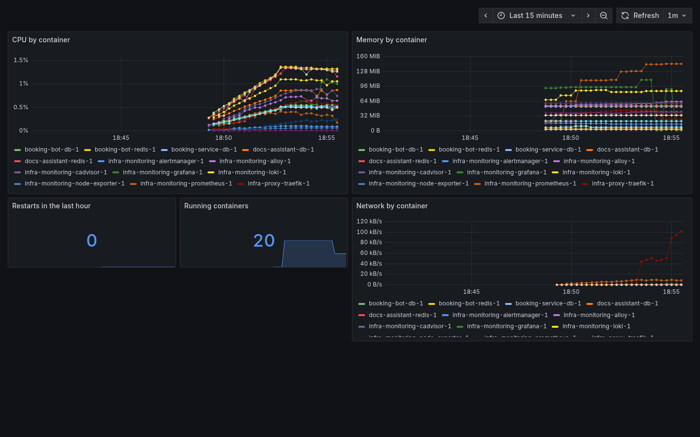
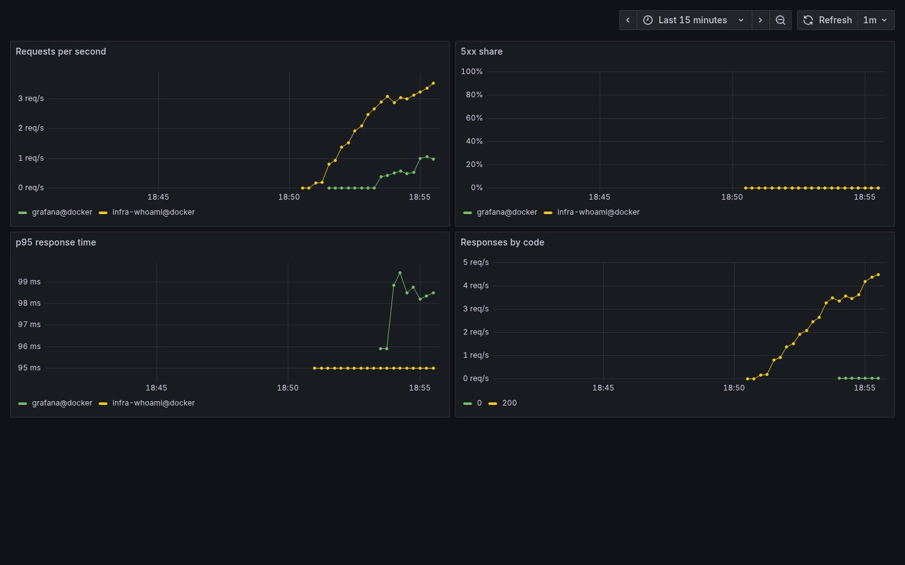

# infra

[](https://github.com/sanjar2709/infra/actions/workflows/ci.yml)

Everything needed to run my portfolio projects on one small VPS: a playbook that turns a fresh Ubuntu server
into something I'm not afraid to leave on the internet, Traefik with HTTPS in front of the apps, deploys from
GitHub Actions, monitoring with alerts in Telegram, and nightly database backups.

The apps: [shop-api](https://github.com/sanjar2709/shop-api), [booking-service](https://github.com/sanjar2709/booking-service),
[taskboard](https://github.com/sanjar2709/taskboard), [booking-bot](https://github.com/sanjar2709/booking-bot),
[docs-assistant](https://github.com/sanjar2709/docs-assistant).

## How it fits together

```
 git push ──▶ app repo CI: tests ─▶ build image ─▶ ghcr.io/sanjar2709/<app>:<sha>
                                                        │
                                   ssh deploy@server ───┴──▶ deploy-app <app> <sha>

 ┌──────────────────────────── VPS (Ubuntu 24.04) ────────────────────────────┐
 │ ufw: 22, 80, 443 only · fail2ban · ssh keys only, no root                  │
 │                                                                            │
 │ Traefik ── Let's Encrypt ── shop-api.DOMAIN   booking.DOMAIN               │
 │    │                         taskboard.DOMAIN docs.DOMAIN  grafana.DOMAIN  │
 │    ▼                                                                       │
 │ /opt/stacks/apps/<app>   one compose project per app, own db network       │
 │ /opt/stacks/monitoring   Prometheus, Alertmanager, Grafana, Loki, Alloy    │
 │ backup-db.timer          pg_dump of every app at 03:00, kept 7 days        │
 └────────────────────────────────────────────────────────────────────────────┘
```

## Setting up a server

You need a server with Ubuntu 24.04 that you can reach as root with an SSH key, and a domain with
`*.yourdomain` pointing at it.

```bash
python -m venv .venv && source .venv/bin/activate
pip install -r requirements.txt
cd ansible
ansible-galaxy collection install -r requirements.yml

cp inventory/hosts.example.yml inventory/hosts.yml                    # server address
cp inventory/group_vars/all.example.yml inventory/group_vars/all.yml  # domain, your public key, apps
ansible-vault create inventory/group_vars/vault.yml                   # passwords and keys, see below

ansible-playbook playbooks/setup.yml           # first run, as root
ansible-playbook playbooks/deploy.yml -u deploy --ask-vault-pass
```

`setup.yml` does the boring but important part:

- installs base packages, turns on unattended security upgrades, sets the timezone, adds swap
- creates a `deploy` user with your key and passwordless sudo
- SSH: no root login, no passwords, only the `deploy` user (the config is checked with `sshd -t` before it's applied,
  so a typo can't lock you out)
- ufw lets in only SSH, 80 and 443; fail2ban bans IPs that keep failing SSH logins
- Docker from Docker's own repository, with log rotation so container logs can't fill the disk

`deploy.yml` copies `proxy/`, `apps/` and `monitoring/` to `/opt/stacks`, writes each app's `.env` from
`group_vars` and the vault, and starts everything. Both playbooks can be run again at any time; a second
`setup.yml` run changes nothing.

Secrets never go into git. `vault.yml` holds them as `vault_*` variables, and `all.yml` refers to them:

```yaml
# vault.yml (encrypted)
vault_taskboard_secret_key: "..."
vault_taskboard_db_password: "..."
vault_grafana_password: "..."
vault_alert_bot_token: "123456:ABC..."
```

## Deploys

Each app repo builds its image in CI after the tests pass and pushes it to GHCR with two tags, `latest` and the
commit sha. If the repo has a `DEPLOY_HOST` variable and a `DEPLOY_SSH_KEY` secret, the next job connects as
`deploy` with its own key and runs:

```bash
deploy-app taskboard 72d240e...    # pull that tag, restart what changed, clean old images
```

Rolling back is the same command with an older sha.

The CI key (`deploy_ci_ssh_public_key`) is not a normal login. In `authorized_keys` it is tied to
`restrict,command="/usr/local/bin/deploy-app"`, so whatever CI sends, the server runs deploy-app, which reads the
request from `SSH_ORIGINAL_COMMAND` and accepts only an existing app name and a plain tag. No shell, no sudo,
no port forwarding. If that key ever leaks, the worst someone can do is redeploy an image that is already on GHCR.

The images come from public repos, so they are public on GHCR too and the server pulls them without logging in.

## Monitoring

| | |
|---|---|
| Prometheus | node-exporter (CPU, memory, disk), cAdvisor (every container), Traefik (requests, status codes, latency) |
| Grafana | at `grafana.DOMAIN`, with three dashboards provisioned from this repo: Server, Containers, Traefik |
| Loki + Alloy | logs of every container, searchable in Grafana by `project` and `service` |
| Alertmanager | sends alerts to a Telegram chat |




Alerts in `monitoring/prometheus/alerts.yml`: something stopped answering, disk over 85%, less than 10% memory free,
CPU above 90% for 15 minutes, a container restarting in a loop, more than 5% of requests to an app ending in 5xx,
and no successful database backup for more than 26 hours.

## Backups

`backup-db` runs every night from a systemd timer. It finds every app with a `db` service, runs `pg_dump -Fc`
inside the container (so no passwords are needed on the host), and keeps 7 days of dumps in
`/var/backups/postgres/<app>/`. A dump is written to a temporary file first and renamed only when `pg_dump`
succeeded, so a half-written file never looks like a backup.

After each good dump it writes the time to a file node-exporter picks up, which is how Prometheus knows when
backups stop working.

```bash
sudo backup-db taskboard     # right now, one app
sudo restore-db taskboard    # newest dump; or give a file. Stops the app, restores, starts it again
```

The dumps stay on the same server. That covers "I ran a bad migration", not "the server is gone";
for that they should also be copied somewhere else (rclone to an S3 bucket would be the next step).

## Tests

```bash
tests/run-server-tests.sh
```

Starts a throwaway Ubuntu 24.04 container with systemd and SSH, and runs the real playbooks against it:

- `setup.yml` twice, and the second run must report `changed=0`
- the `deploy` user can sudo, root login is refused, password login is off, ufw and fail2ban are up, Docker runs containers
- `deploy.yml` with Traefik, a test app behind it (checked over HTTPS) and the whole monitoring stack: all Prometheus
  targets up, Grafana has its dashboards
- a pgvector database gets a row, `backup-db` runs from its systemd unit, the table is dropped,
  `restore-db` brings the row back, and Prometheus sees the backup time
- `deploy-app` works and refuses names like `../../etc`; the CI key can run deploy-app and nothing else

CI runs the same script on every push, after yamllint, ansible-lint (production profile), shellcheck,
`docker compose config` for every stack, and promtool and amtool checks.

To try the proxy and an app on your own machine without a domain, there is `proxy/compose.local.yml`
(plain HTTP on port 8080, `*.localhost` host names).

## Layout

```
ansible/
  playbooks/     setup.yml (the server), deploy.yml (the stacks)
  roles/         base, users, ssh, firewall, fail2ban, docker, stacks, backups
proxy/           Traefik
apps/            a compose file and .env.example per app
monitoring/      Prometheus rules, Alertmanager, Loki, Alloy, Grafana dashboards
tests/           the throwaway test server
```

## License

MIT
